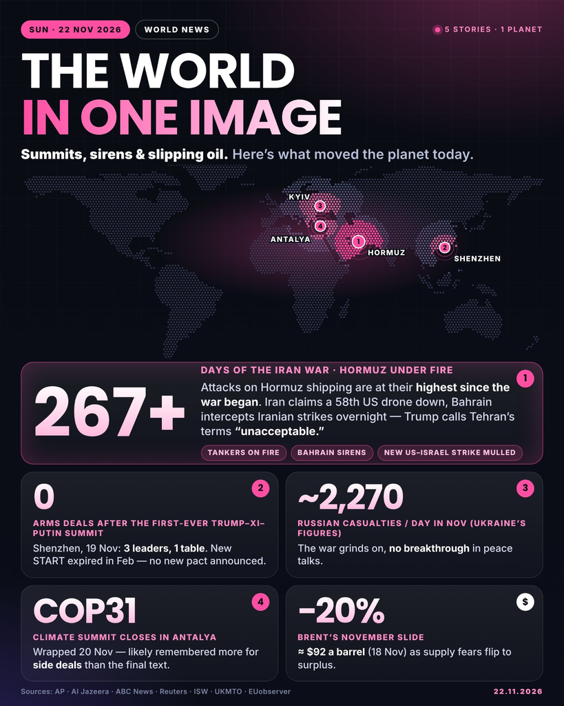

# news-image-20261122-r2

Round 2 entry for the **news-image-20261122** bounty: the user's own
poster design — "THE WORLD IN ONE IMAGE", Sunday 22 November 2026 —
five stories, one planet, on a near-black dotted world map with hot
pink accents. The poster is the user's own artwork, resized to
819×1024 to fit the competition's 1024×1024 gate.

## The stories

1. **267+ — Days of the Iran war · Hormuz under fire** — Attacks on
   Hormuz shipping are at their highest since the war began. Iran
   claims a 58th US drone down, Bahrain intercepts Iranian strikes
   overnight — Trump calls Tehran's terms "unacceptable."
2. **0 — Arms deals after the first-ever Trump–Xi–Putin summit** —
   Shenzhen, 19 Nov: 3 leaders, 1 table. New START expired in Feb —
   no new pact announced.
3. **~2,270 — Russian casualties / day in Nov (Ukraine's figures)** —
   The war grinds on, no breakthrough in peace talks.
4. **COP31 — Climate summit closes in Antalya** — Wrapped 20 Nov —
   likely remembered more for side deals than the final text.
5. **−20% — Brent's November slide** — ≈ $92 a barrel (18 Nov) as
   supply fears flip to surplus.

Sources: AP · Al Jazeera · ABC News · Reuters · ISW · UKMTO ·
EUobserver.

## How it works

`main.ts` (Node 22, standard library only, no network) copies the
poster `entry.png` to `$MAKEFUN_OUTPUT_DIR/entry.png` and self-checks
the copy: PNG magic, at most 1024×1024 pixels, at most 1 MiB, whole
file (complete IEND chunk). Both runs write byte-identical output.
It never removes the output directory itself; it only writes the
file inside it.

Entry for the [make.fun bounty](https://make.fun/bounty/news-image-20261122).
